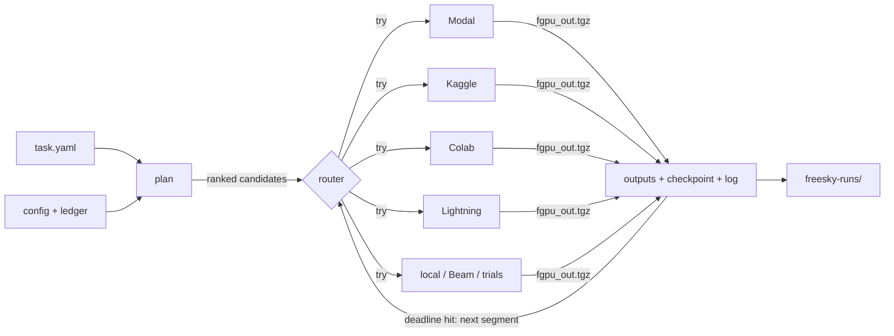

<div align="center">

# ☁️ freesky

**Like SkyPilot, but only free GPUs.**

Write a job once. freesky runs it on whichever free GPU tier has room right now —<br>
Modal, Kaggle, Colab, Lightning AI, Beam, cloud trial credits or your own machine —<br>
and moves on to the next one when a provider is full, out of quota or logged out.

[](LICENSE)


[Why](#why-freesky) · [Quickstart](#quickstart) · [Jobs](#jobs) · [Long jobs](#jobs-longer-than-any-free-session) · [Endpoints](#endpoints-on-free-gpus) · [Providers](#providers) · [How it works](#how-it-works) · [FAQ](#faq)

</div>

---

## Why freesky

There is a surprising amount of free GPU compute in the world: $30 a month on Modal, about 30 hours a week on Kaggle, a T4 on Colab when one is free, monthly credits on Lightning AI, hundreds of dollars of cloud trial credit. The catch is that it is scattered. Every provider has its own CLI, its own quota, its own session limit and its own bad days.

freesky treats all of it as **one pool**:

| You want to… | freesky does |
|---|---|
| run a script on a GPU | picks the provider that can start soonest and has quota left, ships your code, brings outputs back |
| not babysit failures | when a provider has no GPU, is out of quota or rejects your login, it cools that provider down and tries the next |
| train for 40 hours on 12-hour sessions | splits the run at each session limit, saves your checkpoint, resumes on the next free provider |
| call a model from your app | serves it behind a local URL, starts it on demand, stops it when idle, moves it if it dies |
| know what is left | tracks hours, dollars and credits per provider in one ledger and a small dashboard |

It is the same idea as [OmniRoute](https://github.com/diegosouzapw/OmniRoute) (one endpoint, many free LLM providers, automatic failover), applied to GPU compute.

## Quickstart

```bash
git clone https://github.com/christianderrico/Freesky && cd Freesky
pip install -e '.[modal,kaggle]'      # add the extras for the providers you use

freesky init                          # writes ~/.freesky/config.yaml
modal setup                           # log in to the providers you want, with your own accounts
kaggle auth login

freesky providers                     # what is ready on this machine
freesky launch examples/hello-gpu/task.yaml
```

`hello-gpu` reports which provider and GPU it landed on; outputs and logs end up in `freesky-runs/`.

## Jobs

A job is a small YAML file, in the spirit of a SkyPilot task:

```yaml
name: finetune
resources:
  accelerator: any            # none | T4 | P100 | L4 | A10G | A100 | H100 | any
  min_gpu_memory_gb: 16
  max_runtime: 2h
  estimated_runtime: 45m      # used to estimate how much free quota the job will use
image: python:3.12-slim       # for container-based providers (Modal, Beam)
workdir: .                    # shipped to the provider (up to 30 MB)
setup: pip install -r requirements.txt
run: python train.py
outputs: [out]                # copied back to freesky-runs/<job>-<time>-<provider>/outputs/
env: {HF_HOME: /tmp/hf}
providers: [modal, kaggle, colab, lightning, local]   # optional: allow-list and order
```

```bash
freesky plan finetune.yaml       # which providers would be tried, in which order, and why others are skipped
freesky launch finetune.yaml     # run it
```

`plan` explains every decision (example output):

```
task finetune: any, max 7200s (policy fastest)
  -> modal        T4, ~0.45 usd of 29.41 left
  -> colab        T4, ~0.77 hours of 12.00 left
  -> kaggle       T4, ~0.82 hours of 25.50 left
     lightning    cooling down for 12 min (capacity: no GPU available)
     local        no suitable GPU (any, >= 16 GB)
```

If your own command fails, freesky stops there: it does not burn another provider's quota on an error that would happen again.

## Jobs longer than any free session

Free sessions end: Kaggle after 12 hours, Colab after about 12, free Lightning Studios every 4. Add one line to your job:

```yaml
checkpoint: ckpt
```

and freesky runs it as a chain of segments. Near the end of each session it sends your process `SIGTERM`, waits for it to save, brings `ckpt/` back, and starts the next segment on whichever provider is free — the same one or a different one (example output):

```
> trying lightning (T4), segment 1, deadline 13800s
  segment 1 reached its deadline on lightning; checkpoint saved
> segment 2: resuming from the checkpoint
> trying kaggle (T4), segment 2, deadline 42600s
...
segments: lightning -> kaggle -> colab -> kaggle
```

Your code only has to follow a simple contract:

```python
ckpt = os.environ["FREESKY_CHECKPOINT_DIR"]
state = load(ckpt) if os.environ["FREESKY_RESUME"] == "1" else fresh()
signal.signal(signal.SIGTERM, lambda *_: (save(state, ckpt), sys.exit(0)))
for step in range(state.step, total):
    train_step(); maybe_save(state, ckpt)       # periodic saves also cover hard preemption
```

A full example lives in [`examples/resumable-training`](examples/resumable-training).

## Endpoints on free GPUs

Some models are not batch jobs: you want to call them. Add a `service` block:

```yaml
name: kev-endpoint
resources: {accelerator: any, min_gpu_memory_gb: 16}
setup: ...                           # install the model server
run: python -m kev.serve --host 0.0.0.0 --port 8009
service:
  port: 8009
  health: /v1/models
  idle_timeout: 10m
providers: [modal, beam, local]
```

```bash
freesky serve examples/kev-endpoint/task.yaml --port 9000
curl localhost:9000/v1/systemone -d '{...}'      # your app talks to localhost
curl localhost:9000/_freesky/status               # where the replica runs, uptime, history
```

- **Scale to zero**: nothing runs until the first request (or `--warm`).
- **Idle shutdown**: after `idle_timeout` without traffic the replica stops, so credit is spent only while you use it.
- **Failover**: if the replica dies or stops answering its health check, that provider cools down and a new replica starts elsewhere; the request is retried once.

Endpoints use only providers whose free tier allows exposing a port: Modal (encrypted tunnels), Beam (exposed ports) and your own machine.

## Providers

| Provider | Free offer | Jobs | Endpoints | Session limit | Status |
|---|---|:-:|:-:|---|---|
| **local** | your own GPU or CPU | ✓ | ✓ | – | supported |
| **Modal** | $30 / month credit, T4 to H100 | ✓ | ✓ | 24 h | supported |
| **Kaggle** | ~30 GPU-hours / week, T4 ×2 | ✓ | | 12 h | supported |
| **Colab** | T4 when available | ✓ | | ~12 h | supported |
| **Lightning AI** | monthly free credits | ✓ | | 4 h | supported |
| **Beam** | free signup hours | ✓ | ✓ | – | experimental |
| **GCP / Azure / OCI / AWS trials** | $100–$300 of trial credit, via SkyPilot | ✓ | | – | experimental |

`freesky providers -v` shows the full **world catalog** of 23 free GPU sources, including ones without a job API (Baidu AI Studio, ModelScope, Tianchi, Intel Tiber AI Cloud, Saturn Cloud…) and closed ones (SageMaker Studio Lab), with notes on each. Free tiers change often: every limit is an estimate you can override in the config.

### Configuration

```yaml
# ~/.freesky/config.yaml
policy: fastest            # fastest | save-scarce | order

providers:
  modal: {}
  kaggle: {oauth: true}
  colab: {auth: adc, quota_limit: 12}
  lightning: {teamspace: my-teamspace}
  beam: {}
  local: {allow_cpu_fallback: true}
  gcp-trial:               # one entry per credit account
    type: skypilot
    quota_limit: 300
    quota_window: total
    resources: {infra: gcp}
```

| Policy | Picks first |
|---|---|
| `fastest` | the provider that starts soonest (local GPU, then serverless, then notebooks) |
| `save-scarce` | the provider with the largest share of its quota left, saving the scarce ones for later |
| `order` | the order of your config, or of the job's `providers:` list |

<details>
<summary><b>Logging in to each provider</b></summary>

| Provider | How |
|---|---|
| Modal | `modal setup` |
| Kaggle | `kaggle auth login` (then `oauth: true`), or `KAGGLE_API_TOKEN` |
| Colab | `gcloud auth application-default login --scopes=openid,https://www.googleapis.com/auth/cloud-platform,https://www.googleapis.com/auth/userinfo.email,https://www.googleapis.com/auth/colaboratory`, then `auth: adc` |
| Lightning | `LIGHTNING_USER_ID` and `LIGHTNING_API_KEY` from Settings → Keys, plus `teamspace:` |
| Beam | `beam configure` |
| Cloud trials | `pip install 'skypilot[gcp]' && sky check` |

</details>

## Dashboard and coding agents

```bash
freesky dashboard                         # http://127.0.0.1:8790
```

One page with the free compute left across providers, which ones are ready or cooling down, recent runs and the world catalog.

```bash
claude mcp add freesky -- freesky mcp     # or any MCP-capable agent
```

The MCP server gives agents five tools — `list_providers`, `quota`, `plan`, `launch`, `history` — so you can say *"train this on a free GPU"* and let the agent pick, run and report where it ran.

## How it works



1. **Plan.** For each provider freesky checks: is there a GPU that fits? Are credentials present? Is it cooling down after a failure? Is there enough quota left for the estimated runtime plus start-up time? Candidates are ranked by the policy.
2. **Run.** Every provider executes the same generated **Python driver**. It carries your workdir, runs `setup` and `run` in their own process group, enforces the segment deadline (`SIGTERM`, then `SIGKILL` after a grace period), and packs outputs, checkpoint, log and a result file into one archive. An adapter only needs to *upload a file, run Python, download a file*, which keeps each one around 100–150 lines.
3. **Account.** Every attempt goes into a local ledger (`~/.freesky/ledger.jsonl`) with time and cost in the provider's own unit. Quota windows (day, week, month, one-off) are computed from it, unless the provider reports its real quota (Kaggle does). Failures put the provider on a cooldown that depends on the error — no capacity: 15 min, quota: 6 h, login: a day — and doubles on repeated failures.
4. **Clean up.** Sandboxes, notebook sessions, studios and VMs are always stopped at the end, including after errors, so nothing keeps eating your free credit.

| Provider | Mechanism |
|---|---|
| local | subprocess; GPU detected with `nvidia-smi` |
| Modal | `modal.Sandbox` + filesystem API; endpoints through encrypted tunnels |
| Kaggle | private script kernel (`kernels push` with a T4), larger workdirs via a private dataset, quota via `quota_view` |
| Colab | Google's official Colab CLI: `new --gpu T4`, `upload`, `exec`, `download`, `stop` |
| Lightning | `lightning_sdk.Studio`: start, upload, `run_with_exit_code`, download, stop |
| Beam | `beam.Sandbox`: file upload/download, `process.exec`, `expose_port` |
| Trial credits | SkyPilot: `sky launch`, `rsync`, `sky down` |

## How it compares

| | **freesky** | [omnirun](https://github.com/flyingleafe/omnirun) | [SkyPilot](https://github.com/skypilot-org/skypilot) |
|---|---|---|---|
| Made for | free tiers only | your clusters, free notebooks, GPU marketplaces | paid clouds and Kubernetes |
| Modal, Lightning, Beam, trial credits | ✓ | – | trials via its cloud backends |
| Resume past session limits, across providers | ✓ | – (non-goal) | managed-job recovery from spot preemption |
| Endpoints with scale-to-zero and failover | ✓ | – | SkyServe |
| Failover on a direct launch | ✓ | queue mode | ✓ |
| Ships uncommitted code | ✓ | – (needs a pushed commit) | ✓ |
| Dashboard / agents | ✓ / MCP server | – / agent skill | ✓ / agent skill |

omnirun has a much more battle-tested scheduler and is the better tool for Slurm and SSH clusters. SkyPilot is the reference for paid multi-cloud. freesky is for getting real work done for $0.

## FAQ

**Can I share one account across users, or create several to stack quotas?**
No. Free tiers are personal: shared or duplicate accounts break the terms of every provider listed here and get banned. freesky is built around *your* accounts, the same way SkyPilot uses your own cloud credentials.

**Is it really free?**
Modal, Kaggle, Colab and Lightning are free within their monthly or weekly allowances, and freesky tracks those. Trial credits and Beam hours are one-off. Beyond any allowance the provider bills you, so keep an eye on `freesky quota`.

**Are endpoints private?**
Not by default. Modal and Beam give public URLs: anyone who has the URL can call your model while the replica is up. Add authentication in your server if that matters.

**What happens on a hard preemption (Colab reclaims the VM mid-run)?**
The segment fails, the provider cools down and the job resumes elsewhere from the last checkpoint that came back. Save periodically, not only on `SIGTERM`.

**How big can my code be?**
The workdir is shipped with each run, up to 30 MB. Download datasets and model weights inside `setup` (from Hugging Face, a bucket, a URL).

## Project status

**Alpha (v0.2).** The core — planning, ledger, failover, resumable segments, endpoints, CLI, dashboard, MCP — is covered by 22 tests with real local execution. The Modal, Kaggle, Colab, Lightning and Beam adapters are written against the current SDKs (modal 1.6, kaggle 2.2, lightning-sdk 2026.11, google-colab-cli 0.8, beam-client 0.2) and tested against simulators that really run the driver, **but not yet against real accounts**. Reports from real runs are the most useful contribution right now.

### Roadmap

- [ ] Real-account test matrix for every supported provider
- [ ] Real quota readers for Modal and Lightning
- [ ] Hugging Face ZeroGPU adapter
- [ ] Checkpoint sync during a segment, to lose less on hard preemption
- [ ] More than one replica per endpoint, and request queueing during cold starts

## Contributing

```bash
pip install -e '.[dev]'
pytest
```

A new provider is one file in [`freesky/providers/`](freesky/providers): implement `available()`, `launch()` (and `serve()` if the free tier allows endpoints), declare its quota, GPUs and session limit, and add a simulator test in `tests/test_adapters.py`. If you know a free GPU source that is missing from the catalog, open an issue with a link to its terms.

## License

[Apache-2.0](LICENSE).
